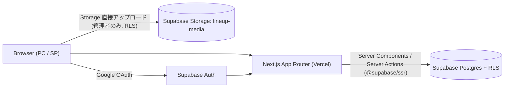
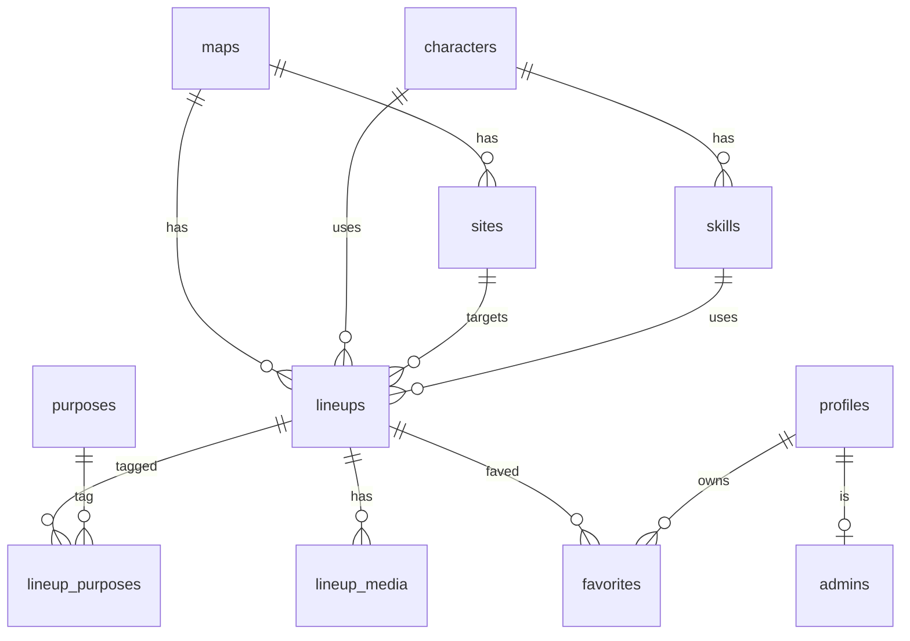

# VALO SET — 実装設計書 (docs/spec.md)

- 元仕様: [valo_specification.md](../valo_specification.md)（v1.0）
- 本書は元仕様の「未決定事項」をヒアリングで確定し、実装レベルに落とし込んだ設計書である。
- 最終更新: 2026-10-20

---

## 0. ヒアリング決定事項（元仕様 §15 の確定）

| # | 項目 | 決定内容 |
|---|---|---|
| 1 | Supabase環境 | 未作成。**モックデータは作らない**。`.env.local` にキー設定後に動作する。未設定時は「環境未設定」画面を表示 |
| 2 | スタイリング | Tailwind CSS v4 |
| 3 | デザイン | VALORANT公式風：ダーク基調＋レッド `#FF4655`、角ばったシャープなUI |
| 4 | タイトル・説明文 | タイトル**任意**（未入力時は「キャラ / サイト / 攻防 / スキル」から自動生成して表示）。**説明文なし** |
| 5 | 用途 | **任意・複数選択**。選択肢は固定（DBマスタ）：索敵／解除阻止／エントリー支援／リテイク／ポストプラント／足止め・遅延 |
| 6 | メディア | 動画・画像の**どちらか一方以上必須、両方可、複数可**。動画 mp4/webm ≤50MB、画像 png/jpg/webp ≤5MB |
| 7 | 並び順 / 削除 | 新しい登録順（`created_at desc`）／**論理削除**（`deleted_at`） |
| 8 | 管理者 | `admins` テーブルに `user_id` をSQLで登録。RLSの `is_admin()` で検証 |
| — | 座標 | 正規化座標（0.0〜1.0, 左上原点）で `numeric(6,5)` 保存。画像サイズに非依存 |
| — | マップ画像 | `images/map/mini`（俯瞰図）をピン表示用、`images/map/main`（スプラッシュ）をマップ選択カード用に使用。`public/images` に配置（静的管理） |
| — | エラー/空状態 | 検索結果なし・通信失敗・メディア読込失敗・未ログイン・権限なし・環境未設定 のそれぞれに専用表示 |

---

## 1. アーキテクチャ



| 層 | 技術 | 備考 |
|---|---|---|
| フレームワーク | Next.js (App Router) + TypeScript | Server Components 中心 |
| スタイル | Tailwind CSS v4 | トークンは `globals.css` の `@theme` |
| 認証 | Supabase Auth (Google) | `@supabase/ssr` で Cookie セッション。middleware でリフレッシュ |
| DB | Supabase Postgres | RLS 全テーブル有効 |
| Storage | Supabase Storage `lineup-media` | 公開読取 / 管理者のみ書込 |
| バリデーション | Zod | Server Action 入力検証 |
| アイコン | lucide-react | |

### 1.1 セキュリティ方針
- 権限判定は**必ずDB側（RLS + `is_admin()`）**で保証。画面側のガードはUX目的のみ。
- 管理画面は Server Component の layout で `is_admin()` RPC を呼び、非管理者は 403 表示。
- 書込は Server Action（ユーザーセッションのクライアント）経由 → RLS が最終防衛。
- 50MB動画は Server Action のボディ上限を超えるため、**ブラウザから Storage へ直接アップロード**（Storage RLS で管理者のみ許可）。DBへのメディア登録は Server Action。
- `service_role` キーはアプリで**使用しない**。

---

## 2. 画面・ルーティング

| パス | 画面 | ログイン | 主なコンポーネント |
|---|---|---|---|
| `/` | マップ選択（トップ） | 不要 | `Hero`, `MapCard` |
| `/maps/[slug]` | 定点検索（マップ＋一覧連動） | 不要 | `FilterBar`, `MapCanvas`, `LineupList`, `LineupPanel` |
| `/lineups/[id]` | 定点詳細（共有用パーマリンク） | 不要 | `LineupDetail`, `MediaGallery`, `FavoriteButton` |
| `/favorites` | お気に入り一覧 | 必要 | `LineupCard` |
| `/login` | ログイン | — | Googleログインボタン |
| `/auth/callback` | OAuthコールバック (Route Handler) | — | |
| `/auth/signout` | ログアウト (Route Handler, POST) | — | |
| `/admin` | 管理：定点一覧 | 管理者 | 編集・削除 |
| `/admin/lineups/new` | 管理：新規登録 | 管理者 | `LineupForm`, `PositionPicker`, `MediaUploader` |
| `/admin/lineups/[id]/edit` | 管理：編集 | 管理者 | 同上 |

### 2.1 定点検索画面の状態管理
- 検索条件は **URLクエリ** で保持（共有・戻る操作対応）：
  `?agent=cypher&side=attack&site=A&skill=<uuid>&purpose=recon,retake&lineup=<uuid>`
- データ取得は Server Component で実施 → クライアントの `LineupExplorer` に渡す。
- ピン⇔一覧の連動はクライアント状態（`selectedId`, `hoveredId`）。
  - ピン選択 → 一覧の該当カードを強調＋スクロール
  - カード選択 → ピン強調＋開始位置→着弾位置の軌跡ライン表示
  - 選択時に詳細パネル（PC: 右ペイン内 / SP: ボトムシート）表示

### 2.2 レスポンシブ
| 幅 | レイアウト |
|---|---|
| ≥1024px (PC) | 左：マップ（正方形） / 右：一覧＋詳細 の横並び |
| <1024px (SP) | 上部にフィルタ（横スクロールチップ）、「MAP / LIST」タブ切替、詳細はフルスクリーンシート |

---

## 3. データベース設計



| テーブル | 主なカラム | 備考 |
|---|---|---|
| `maps` | id, slug, name_ja, name_en, minimap_path, splash_path, sort_order, is_active | マスタ（seed） |
| `sites` | id, map_id, code(`A`/`B`/`C`), sort_order | unique(map_id, code) |
| `characters` | id, slug, name_ja, name_en, role, icon_path, sort_order, is_active | マスタ |
| `skills` | id, character_id, slot(`C`/`Q`/`E`/`X`), name_ja, name_en | unique(character_id, slot) |
| `purposes` | id, slug, name_ja, sort_order | 用途マスタ |
| `lineups` | id(uuid), title(null可), map_id, character_id, side(`attack`/`defense`), site_id, skill_id, start_x, start_y, land_x, land_y, aim_note(null可), status(`published`), created_by, created_at, updated_at, deleted_at | 照準位置はスクショ（role=`aim`）＋任意の短い補足 `aim_note` |
| `lineup_purposes` | lineup_id, purpose_id | PK(両方) |
| `lineup_media` | id, lineup_id, kind(`video`/`image`), role(`execution`/`aim`/`other`), storage_path, mime_type, size_bytes, sort_order, created_at | |
| `favorites` | user_id, lineup_id, created_at | PK(user_id, lineup_id) で重複防止 |
| `profiles` | id(=auth.users.id), display_name, avatar_url, created_at | サインアップ時トリガで自動作成 |
| `admins` | user_id(PK), created_at | SQLで手動登録 |

- `status` は将来の投稿・審査機能用（初期は `published` 固定）。
- 整合性トリガ：`lineups.site_id` が `map_id` に属すること、`skill_id` が `character_id` に属することを検証。
- `updated_at` 自動更新トリガ。

### 3.1 RLS ポリシー

| テーブル | SELECT | INSERT / UPDATE / DELETE |
|---|---|---|
| マスタ系（maps, sites, characters, skills, purposes） | 全員 | 管理者のみ |
| `lineups` | 全員：`deleted_at is null and status='published'` ／ 管理者：全件 | 管理者のみ（削除は UPDATE で `deleted_at` を設定） |
| `lineup_purposes`, `lineup_media` | 親 lineup が閲覧可能なら可 | 管理者のみ |
| `favorites` | 本人のみ | 本人のみ（`user_id = auth.uid()`） |
| `profiles` | 本人のみ | 本人のみ UPDATE |
| `admins` | 本人のレコードのみ | 不可（SQLのみ） |

- `is_admin()`：`security definer`、`exists(select 1 from admins where user_id = auth.uid())`。

### 3.2 Storage
- バケット `lineup-media`（public read）。パス：`lineups/{lineup_id}/{uuid}.{ext}`
- 書込・削除ポリシー：`bucket_id='lineup-media' and is_admin()`
- バケット側の `file_size_limit=50MB`、`allowed_mime_types` を設定。画像5MBはクライアント＋Server Actionで検証。

---

## 4. 主要処理フロー

### 4.1 定点検索
1. `/maps/[slug]` で map をslug取得（存在しない→404）
2. クエリ条件で `lineups` を検索（`purpose` 指定時は `lineup_purposes!inner` で OR 一致）
3. `created_at desc` で返却、ログイン時は自分の `favorites` を併せて取得

### 4.2 管理者 定点登録
1. フォーム入力（マップ→サイト / キャラ→スキル が連動）
2. `PositionPicker` でマップをクリック：開始位置（シアン）→ 着弾位置（レッド）
3. 送信時：① Server Action `saveLineup` で lineups + lineup_purposes を保存（新規は id 発行）
   ② ブラウザから Storage へ直接アップロード ③ Server Action `attachMedia` で `lineup_media` 登録
4. メディア合計（既存＋新規）が0件なら送信不可（クライアント検証＋サーバー側でも件数検証）

### 4.3 お気に入り
- `FavoriteButton`（楽観的更新）→ Server Action `toggleFavorite`。未ログイン時は `/login?next=...` へ誘導。

---

## 5. ディレクトリ構成

```text
valo_set/
├─ docs/ (spec.md, design-spec.md)
├─ images/                 # 元素材（ユーザー提供）
├─ public/images/          # 配信用（maps/, agents/, brand/）
├─ supabase/
│  ├─ migrations/0001_init.sql
│  └─ seed.sql             # マスタデータ（マップ/サイト/キャラ/スキル/用途）
├─ src/
│  ├─ app/                 # ルーティング（§2）
│  ├─ components/          # UI部品
│  ├─ lib/
│  │  ├─ supabase/ (client.ts, server.ts, middleware.ts, env.ts)
│  │  ├─ queries.ts        # 読み取り系
│  │  ├─ actions/          # Server Actions
│  │  ├─ validation.ts     # Zod
│  │  └─ format.ts         # 自動タイトル生成など
│  ├─ types/database.ts
│  └─ middleware.ts
├─ .env.example
└─ README.md
```

---

## 6. 環境変数

| 変数 | 用途 |
|---|---|
| `NEXT_PUBLIC_SUPABASE_URL` | Supabase プロジェクトURL |
| `NEXT_PUBLIC_SUPABASE_ANON_KEY` | anon キー |
| `NEXT_PUBLIC_SITE_URL` | OAuth リダイレクト先のベースURL（例 `http://localhost:3000`） |

---

## 7. 受け入れ条件との対応

| 受け入れ条件（元仕様 §14） | 実装 |
|---|---|
| マップ選択 | `/` |
| 条件絞り込み | `FilterBar` + URLクエリ |
| ピン表示・連動 | `MapCanvas` ⇔ `LineupList` |
| 詳細・動画・画像 | `LineupPanel` / `/lineups/[id]` |
| Googleログイン / 未ログイン閲覧 | Supabase Auth / RLS 公開読取 |
| お気に入り登録・解除・一覧 | `FavoriteButton` / `/favorites` |
| 管理者限定・CRUD | `/admin` + `is_admin()` RLS |
| PC/SP | §2.2 |
| 初期データで検証 | Supabase 作成後、管理画面から登録（モックなし） |
